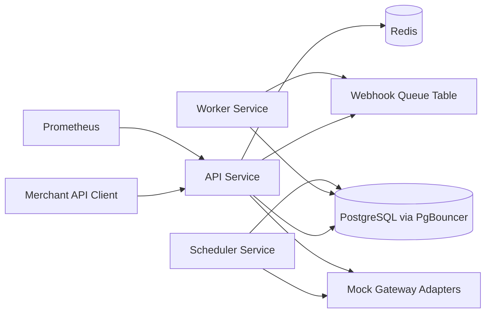

# PayFlow Commerce Architecture

PayFlow Commerce is a FastAPI payment orchestration simulation that models a multi-gateway payment platform across Razorpay, Stripe, PayU, and UPI.

Runtime services:

- API service: payment creation, capture, refund, void, gateway/routing admin, webhook ingress, health, metrics.
- Worker service: durable webhook queue consumption and DLQ progression.
- Scheduler service: reconciliation, UPI expiry, and idempotency cleanup.
- PostgreSQL: source of truth for payment state, attempts, audit trails, idempotency, queues, and reconciliation.
- Redis: low-latency shared state mirror for circuit breakers and future distributed throttles.
- PgBouncer: transaction-pooling front door for PostgreSQL under flash-sale pressure.

Design constraints:

- Money is stored as integer paise only.
- Gateway calls are made after committing intermediate state, so no database transaction is held during external I/O.
- State transitions use row locks and write immutable audit logs.
- Idempotency is scoped by `(merchant_id, operation_type, idempotency_key)`.
- Webhooks are verified before processing and persisted to a durable queue.
