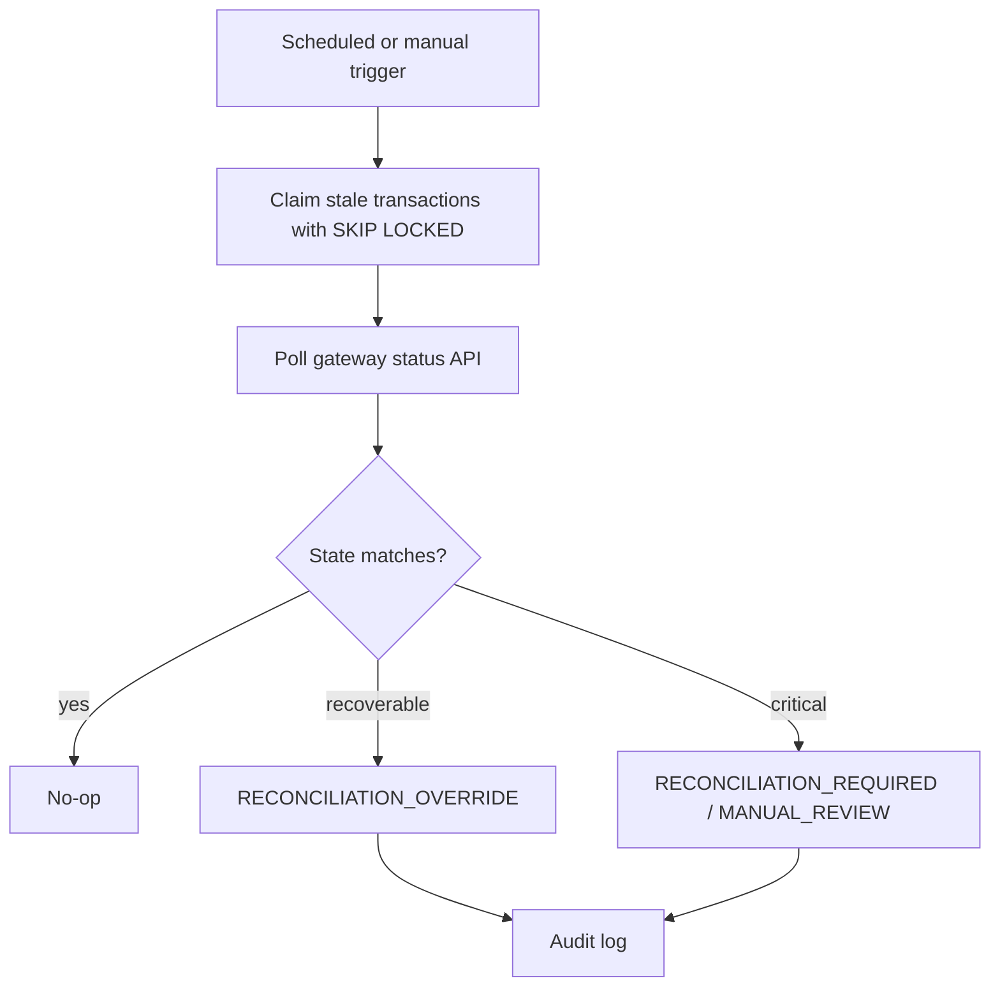

# Reconciliation

The reconciliation engine scans stale in-flight payments, polls mock gateway status, compares gateway truth with internal state, and writes `reconciliation_runs` plus `reconciliation_log` records.

Critical settlement discrepancies are never auto-refunded. They are flagged for human review so the simulation preserves financial consistency.
