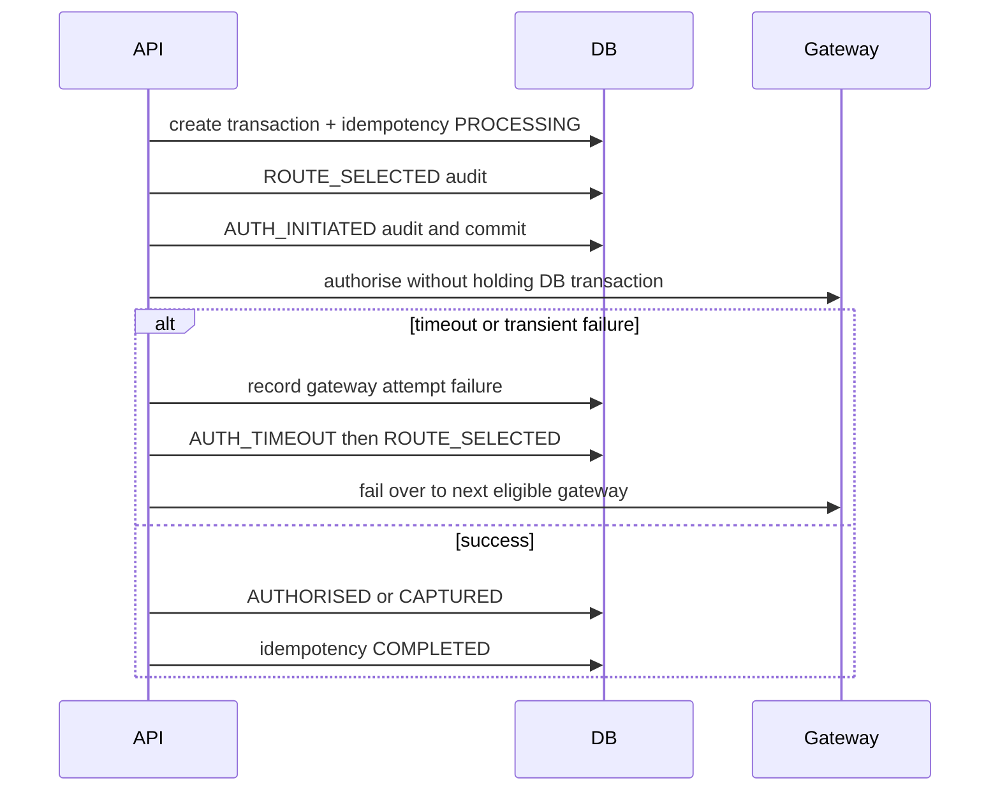

# Retry Lifecycle

Retries are replay-safe because every operation is attached to a payment attempt and every gateway interaction is recorded as a gateway attempt. Hard declines do not fail over; timeouts, rate limits, and gateway unreachability may fail over or be queued depending on the operation.
