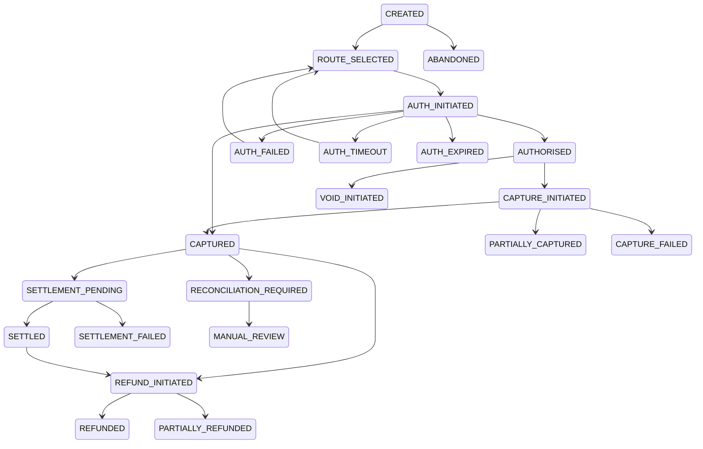

# Payment State Machine

Additional advanced states include `AUTH_PENDING`, `CAPTURE_PENDING`, `SETTLEMENT_FAILED`, `DISPUTED`, `CHARGEBACK`, `REVERSED`, `WEBHOOK_PENDING`, and `RECONCILIATION_REQUIRED`.

Every accepted, rejected, and duplicate no-op transition is recorded in `transaction_state_log`.
