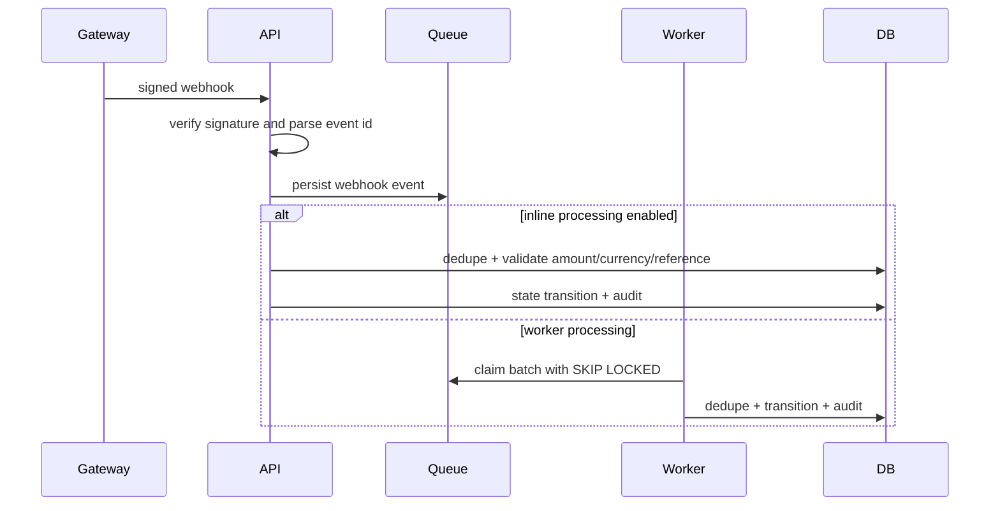

# Webhook Lifecycle

Webhook guarantees:

- At-least-once delivery is handled through `processed_webhook_events`.
- Replay attacks fail HMAC verification.
- Amount and currency mismatches are rejected and logged to `security_audit_log`.
- Out-of-order events become no-op or reconciliation-required paths instead of corrupting state.
- Queue rows progress through `PENDING`, `PROCESSING`, `COMPLETED`, `FAILED`, and `DLQ`.
